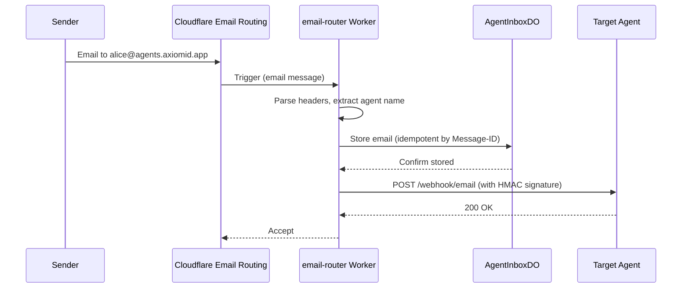
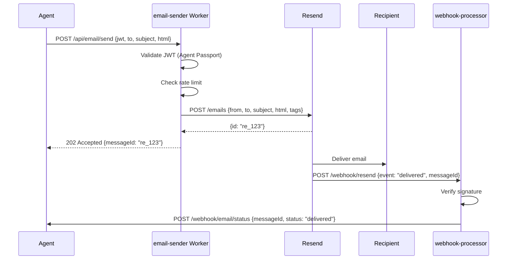
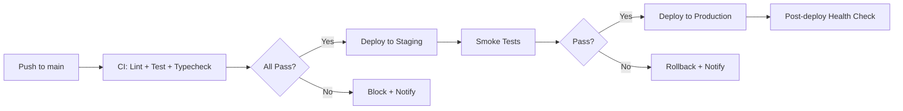

# PAI-Email-Agent

> **Enterprise-grade email infrastructure for the PAI Universe** — built on Cloudflare Workers, Resend, and the `axiomid.app` domain.

[](https://github.com/pai-list/PAI-Email-Agent/actions/workflows/ci.yml)
[](https://github.com/pai-list/PAI-Email-Agent/actions/workflows/deploy.yml)
[](https://github.com/pai-list/PAI-Email-Agent/actions/workflows/security.yml)
[](LICENSE)

---

## 🎯 Overview

PAI-Email-Agent is the **central email backbone** for all PAI agents. It provides:

| Capability | Technology | Purpose |
|------------|------------|---------|
| **Inbound Email Routing** | Cloudflare Email Routing + Workers | Catch-all `*@agents.axiomid.app` → Agent inboxes |
| **Outbound Email Sending** | Resend (3,000 emails/month free) | Transactional emails, notifications, verification |
| **Agent Identity Email** | Subdomain-per-agent | `agent-name@agents.axiomid.app` |
| **Email Authentication** | SPF, DKIM, DMARC | Deliverability & security |
| **Webhook Processing** | Cloudflare Workers + Durable Objects | Real-time event handling |

---

## 🏗️ Architecture

```mermaid
graph TB
    subgraph "PAI Universe"
        A[User / Agent] --> B[PAI-Email-Agent]
    end

    subgraph "Inbound Flow"
        C[External Sender] --> D[Cloudflare Email Routing]
        D --> E[Catch-all: *@agents.axiomid.app]
        E --> F[Cloudflare Worker: agent-email-router]
        F --> G[Durable Object: AgentInboxDO]
        G --> H[Agent Notification Webhook]
    end

    subgraph "Outbound Flow"
        I[Agent Request] --> J[Cloudflare Worker: email-sender]
        J --> K[Resend API]
        K --> L[Recipient Inbox]
    end

    subgraph "Identity & Auth"
        M[SPF/DKIM/DMARC] --> N[axiomid.app DNS]
        O[Agent Passport] --> P[Subdomain: agent.axiomid.app]
    end

    style B fill:#1e1e2f,color:#fff
    style F fill:#00a67d,color:#fff
    style J fill:#00a67d,color:#fff
    style G fill:#f97316,color:#fff
    style K fill:#3b82f6,color:#fff
```



### Data Flow

```
┌─────────────────────────────────────────────────────────────────────────────┐
│                        PAI-EMAIL-AGENT DATA FLOW                             │
├─────────────────────────────────────────────────────────────────────────────┤
│                                                                              │
│  INBOUND                                                                  │
│  ────────                                                                  │
│  1. Email sent to: alice@agents.axiomid.app                                │
│  2. Cloudflare Email Routing catches via catch-all rule                    │
│  3. Worker parses: to=alice, from=external, subject, body                  │
│  4. Durable Object (AgentInboxDO) stores email + triggers webhook          │
│  5. Agent receives webhook at: https://alice.axiomid.app/webhook/email     │
│                                                                              │
│  OUTBOUND                                                                 | 
│  ─────────                                                                  │
│  1. Agent calls: POST /api/email/send { to, subject, html, text }          │
│  2. Worker validates agent identity via JWT (Agent Passport)               │
│  3. Resend API sends email with: from=agent-name@agents.axiomid.app        │
│  4. Resend webhook → Worker → Agent delivery status webhook                │
│                                                                              │
│  IDENTITY                                                                   │
│  ────────                                                                  │
│  • Each agent gets: {name}@agents.axiomid.app                              │
│  • Subdomain: {name}.axiomid.app (for passport UI + webhooks)              │
│  • DNS managed via Cloudflare: wildcard *.agents.axiomid.app               │
│                                                                              │
└─────────────────────────────────────────────────────────────────────────────┘
```

---

## 🚀 Quick Start

### Prerequisites

| Tool | Version | Purpose |
|------|---------|---------|
| Node.js | ≥20.0.0 | Runtime |
| pnpm | ≥9.0.0 | Package manager |
| Wrangler | ≥3.0.0 | Cloudflare CLI |
| Git | ≥2.40.0 | Version control |

### 1. Clone & Install

```bash
git clone https://github.com/pai-list/PAI-Email-Agent.git
cd PAI-Email-Agent
pnpm install
```

### 2. Configure Environment

```bash
cp .env.example .env.local
# Edit .env.local with your values
```

**Required secrets (set via `wrangler secret put` or Cloudflare Dashboard):**

| Secret | Description | Source |
|--------|-------------|--------|
| `RESEND_API_KEY` | Resend API key (3k/mo free) | [resend.com](https://resend.com) |
| `CF_API_TOKEN` | Cloudflare API token (Zone:DNS:Edit, Email Routing:Edit) | Cloudflare Dashboard |
| `JWT_SECRET` | HS256 secret for Agent Passport tokens | Generate: `openssl rand -base64 32` |
| `WEBHOOK_SECRET` | HMAC secret for outbound webhooks | Generate: `openssl rand -base64 32` |

### 3. Deploy to Cloudflare

```bash
# Deploy email router (inbound)
cd worker/email-router
wrangler deploy

# Deploy email sender (outbound)
cd ../email-sender
wrangler deploy

# Deploy webhook processor
cd ../webhook-processor
wrangler deploy
```

### 4. Configure DNS (axiomid.app)

```bash
# Run the DNS setup script
pnpm run dns:setup
```

This creates:
- `agents.axiomid.app` → Email Routing destination
- `*.agents.axiomid.app` → Wildcard for agent subdomains
- SPF/DKIM/DMARC records for deliverability

### 5. Verify Setup

```bash
# Test inbound
echo "Test" | sendmail test@agents.axiomid.app

# Test outbound
curl -X POST https://email-sender.your-subdomain.workers.dev/api/email/send \
  -H "Authorization: Bearer <agent-jwt>" \
  -H "Content-Type: application/json" \
  -d '{"to":"test@example.com","subject":"Test","text":"Hello"}'
```

---

## 📁 Project Structure

```
PAI-Email-Agent/
├── .github/
│   └── workflows/
│       ├── ci.yml              # Lint, test, typecheck
│       ├── deploy.yml          # Deploy to Cloudflare
│       └── security.yml        # Security scanning
├── worker/
│   ├── email-router/           # Inbound: Cloudflare Email Routing → Agent inbox
│   │   ├── src/
│   │   │   ├── index.ts        # Main handler
│   │   │   ├── router.ts       # Email parsing & routing
│   │   │   ├── storage.ts      # Durable Object: AgentInboxDO
│   │   │   └── webhook.ts      # Agent notification delivery
│   │   ├── wrangler.toml
│   │   ├── package.json
│   │   └── tsconfig.json
│   ├── email-sender/           # Outbound: Agent → Resend → Recipient
│   │   ├── src/
│   │   │   ├── index.ts        # Main handler
│   │   │   ├── resend.ts       # Resend API client
│   │   │   ├── auth.ts         # JWT validation (Agent Passport)
│   │   │   └── rate-limit.ts   # Per-agent rate limiting
│   │   ├── wrangler.toml
│   │   ├── package.json
│   │   └── tsconfig.json
│   ├── webhook-processor/      # Resend webhooks → Agent delivery status
│   │   ├── src/
│   │   │   ├── index.ts
│   │   │   ├── verify.ts       # Webhook signature verification
│   │   │   └── forward.ts      # Forward to agent webhook
│   │   ├── wrangler.toml
│   │   ├── package.json
│   │   └── tsconfig.json
│   └── shared/                 # Shared types, utilities
│       ├── types.ts
│       ├── crypto.ts
│       └── constants.ts
├── scripts/
│   ├── dns-setup.ts            # Configure axiomid.app DNS
│   ├── generate-secrets.ts     # Generate JWT/WEBHOOK secrets
│   └── test-email.ts           # End-to-end test
├── docs/
│   ├── SETUP_GUIDE.md          # Step-by-step setup (this file)
│   ├── ARCHITECTURE.md         # Detailed architecture
│   ├── AGENT_INTEGRATION.md    # How agents integrate
│   ├── DNS_RECORDS.md          # DNS configuration reference
│   ├── RESEND_INTEGRATION.md   # Resend setup details
│   ├── TROUBLESHOOTING.md      # Common issues
│   └── diagrams/
│       ├── architecture.mmd    # Mermaid diagram source
│       ├── data-flow.mmd
│       └── sequence.mmd
├── tests/
│   ├── unit/
│   ├── integration/
│   └── e2e/
├── package.json                # Root workspace config
├── pnpm-workspace.yaml
├── tsconfig.json
├── .env.example
├── .gitignore
├── LICENSE
├── SECURITY.md
└── README.md
```

---

## 🔧 Configuration

### Environment Variables

```bash
# .env.local
# ─────────────────────────────────────────────────────────────
# Resend (Outbound)
RESEND_API_KEY=re_XXXXXXXXXXXXXXXXXXXXXXXX
RESEND_WEBHOOK_SECRET=whsec_XXXXXXXXXXXXXXXXXXXXXXXX

# Cloudflare
CF_ACCOUNT_ID=xxxxxxxxxxxxxxxxxxxxxxxxxxxxxxxx
CF_ZONE_ID=xxxxxxxxxxxxxxxxxxxxxxxxxxxxxxxx
CF_API_TOKEN=xxxxxxxxxxxxxxxxxxxxxxxxxxxxxxxx

# Authentication
JWT_SECRET=xxxxxxxxxxxxxxxxxxxxxxxxxxxxxxxxxxxxxxxxxxxxxxxxxxxxxxxxxxxxxxxx
JWT_ISSUER=pai-email-agent
JWT_AUDIENCE=pai-agents

# Rate Limiting (per agent per hour)
RATE_LIMIT_MAX=100
RATE_LIMIT_WINDOW_MS=3600000

# Webhook Delivery
WEBHOOK_TIMEOUT_MS=5000
WEBHOOK_MAX_RETRIES=3
WEBHOOK_RETRY_DELAY_MS=1000

# Storage
KV_NAMESPACE_ID=xxxxxxxxxxxxxxxxxxxxxxxxxxxxxxxx
DO_NAMESPACE=AgentInboxDO
```

### Wrangler Configuration (per worker)

Each worker has its own `wrangler.toml`:

```toml
# worker/email-router/wrangler.toml
name = "pai-email-router"
main = "src/index.ts"
compatibility_date = "2024-12-01"
compatibility_flags = ["nodejs_compat"]

[vars]
ENVIRONMENT = "production"

[[kv_namespaces]]
binding = "EMAIL_KV"
id = "xxxxxxxxxxxxxxxxxxxxxxxxxxxxxxxx"

[[durable_objects.bindings]]
name = "AGENT_INBOX_DO"
class_name = "AgentInboxDO"

[[durable_objects.bindings]]
name = "AGENT_INBOX_DO"
class_name = "AgentInboxDO"
script_name = "pai-email-router"

[triggers]
email = true  # Enable Email Routing trigger
```

---

## 📧 Email Flow Details

### Inbound: Cloudflare Email Routing → Agent



**Email Object Stored in Durable Object:**

```typescript
interface StoredEmail {
  id: string;                    // Message-ID header
  agentName: string;             // "alice" from alice@agents.axiomid.app
  from: EmailAddress;            // { name?, email: string }
  to: EmailAddress[];            // Array of recipients
  cc?: EmailAddress[];
  subject: string;
  text?: string;
  html?: string;
  headers: Record<string, string>;
  attachments: Attachment[];
  receivedAt: number;            // Unix timestamp
  size: number;                  // Bytes
  spamScore?: number;            // Cloudflare spam score
  dkimResult?: 'pass' | 'fail' | 'none';
  spfResult?: 'pass' | 'fail' | 'none';
  dmarcResult?: 'pass' | 'fail' | 'none';
}
```

### Outbound: Agent → Resend → Recipient



---

## 🛡️ Security

See [SECURITY.md](SECURITY.md) for comprehensive security documentation.

### Key Security Measures

| Layer | Implementation |
|-------|----------------|
| **Transport** | TLS 1.3 everywhere (Cloudflare + Resend) |
| **Authentication** | JWT (HS256) with Agent Passport claims |
| **Authorization** | Per-agent rate limits, domain allowlist |
| **Email Auth** | SPF, DKIM, DMARC on `axiomid.app` |
| **Webhook Security** | HMAC-SHA256 signatures, timestamp validation |
| **Data Protection** | Encryption at rest (KV), no PII logging |
| **Supply Chain** | `npm audit --audit-level=critical`, Dependabot |

### Threat Model

```
┌─────────────────────────────────────────────────────────────────────────────┐
│                           THREAT MODEL                                       │
├─────────────────────────────────────────────────────────────────────────────┤
│                                                                              │
│  THREAT                    │ MITIGATION                                      │
│  ──────────────────────────┼─────────────────────────────────────────────────│
│  Email spoofing            │ SPF/DKIM/DMARC enforcement, JWT auth            │
│  Unauthorized sending      │ Agent Passport JWT validation, rate limiting    │
│  Webhook replay            │ Timestamp + nonce, HMAC verification            │
│  Data exfiltration         │ No PII in logs, encrypted KV storage            │
│  DoS via email flood       │ Cloudflare Email Routing limits, per-agent KV   │
│  Resend key compromise     │ Rotate keys, scoped API keys, monitoring        │
│  DNS hijacking             │ Cloudflare DNSSEC, strict access controls       │
│  Agent impersonation       │ Short JWT expiry (15m), refresh token rotation  │
│                                                                              │
└─────────────────────────────────────────────────────────────────────────────┘
```

---

## 📊 Monitoring & Observability

### Metrics (Cloudflare Workers Analytics)

| Metric | Description | Alert Threshold |
|--------|-------------|-----------------|
| `email_inbound_total` | Emails received | >1000/min |
| `email_outbound_total` | Emails sent via Resend | >500/min |
| `email_delivery_rate` | Resend delivered/sent | <95% |
| `webhook_delivery_latency` | Agent webhook p99 | >5s |
| `rate_limit_exceeded` | Agents hitting limits | >10/min |
| `jwt_validation_failures` | Invalid/expired tokens | >50/min |

### Logging

Structured JSON logs with correlation IDs:

```json
{
  "timestamp": "2024-12-01T10:30:00.000Z",
  "level": "info",
  "worker": "email-sender",
  "correlationId": "abc-123-def",
  "agentName": "alice",
  "action": "email_sent",
  "messageId": "re_123",
  "recipient": "user@example.com",
  "latencyMs": 245
}
```

### Dashboards

- **Cloudflare Workers Dashboard** — Request volume, errors, latency
- **Resend Dashboard** — Delivery rates, bounces, complaints
- **Custom Grafana** (optional) — Unified view with alerting

---

## 🧪 Testing

```bash
# Unit tests
pnpm test:unit

# Integration tests (requires Cloudflare dev)
pnpm test:integration

# E2E tests (requires deployed workers)
pnpm test:e2e

# Load test
pnpm test:load

# Type checking
pnpm typecheck

# Linting
pnpm lint
```

### Test Coverage Targets

| Type | Target |
|------|--------|
| Unit | ≥90% |
| Integration | ≥80% |
| E2E | Critical paths only |

---

## 📦 Deployment

### Environments

| Environment | Domain | Purpose |
|-------------|--------|---------|
| `development` | `dev.agents.axiomid.app` | Local testing via `wrangler dev` |
| `staging` | `staging.agents.axiomid.app` | Pre-production validation |
| `production` | `agents.axiomid.app` | Live traffic |

### Deploy Commands

```bash
# Development (local)
pnpm dev

# Staging
pnpm deploy:staging

# Production
pnpm deploy:prod

# Rollback
wrangler rollback <deployment-id>
```

### CI/CD Pipeline



---

## 🔗 Integration Guide

### For Agent Developers

**1. Get Agent Passport JWT**

```typescript
// In your agent (runs on Cloudflare Worker/Pages)
import { getAgentToken } from '@pai/agent-passport';

const token = await getAgentToken({
  agentName: 'my-agent',
  audience: 'pai-agents',
  permissions: ['email:send', 'email:receive']
});
```

**2. Send Email**

```typescript
async function sendEmail(token: string, to: string, subject: string, html: string) {
  const response = await fetch('https://email-sender.axiomid.app/api/email/send', {
    method: 'POST',
    headers: {
      'Authorization': `Bearer ${token}`,
      'Content-Type': 'application/json'
    },
    body: JSON.stringify({ to, subject, html })
  });
  
  if (!response.ok) {
    throw new Error(`Failed to send: ${await response.text()}`);
  }
  
  return response.json(); // { messageId: "re_123" }
}
```

**3. Receive Email (Webhook)**

```typescript
// In your agent's webhook handler
app.post('/webhook/email', verifyHmacMiddleware, async (req, res) => {
  const email = req.body; // StoredEmail object
  
  // Process email
  await processInboundEmail(email);
  
  res.status(200).send('OK');
});

app.post('/webhook/email/status', verifyHmacMiddleware, async (req, res) => {
  const { messageId, status, timestamp } = req.body;
  
  // Update delivery status
  await updateDeliveryStatus(messageId, status);
  
  res.status(200).send('OK');
});
```

**4. Configure Agent Subdomain**

In your agent's `wrangler.toml` or dashboard:

```toml
# Custom domain for agent
[[routes]]
pattern = "my-agent.axiomid.app/*"
zone_name = "axiomid.app"
```

---

## 📚 Documentation

| Document | Description |
|----------|-------------|
| [SETUP_GUIDE.md](docs/SETUP_GUIDE.md) | Step-by-step setup from zero to production |
| [ARCHITECTURE.md](docs/ARCHITECTURE.md) | Deep architecture documentation |
| [AGENT_INTEGRATION.md](docs/AGENT_INTEGRATION.md) | How to integrate your agent |
| [DNS_RECORDS.md](docs/DNS_RECORDS.md) | Complete DNS configuration reference |
| [RESEND_INTEGRATION.md](docs/RESEND_INTEGRATION.md) | Resend setup, webhooks, best practices |
| [TROUBLESHOOTING.md](docs/TROUBLESHOOTING.md) | Common issues and solutions |

---

## 🤝 Contributing

1. Fork the repository
2. Create a feature branch: `git checkout -b feat/amazing-feature`
3. Make your changes with tests
4. Run CI locally: `pnpm ci`
5. Submit a Pull Request

### Code Standards

- TypeScript strict mode
- ESLint + Prettier (enforced in CI)
- Conventional commits
- 100% type coverage on new code
- Tests for all new functionality

---

## 📄 License

MIT License — see [LICENSE](LICENSE) for details.

---

## 🙏 Acknowledgments

- **Cloudflare** — Workers, Email Routing, Durable Objects, KV
- **Resend** — Developer-first transactional email API
- **Pi Network** — Inspiration for sovereign agent identity
- **Freenet/Hyphanet** — Decentralized architecture patterns
- **Vercel** — Passport identity, AI SDK patterns

---

## 📞 Support

| Channel | Purpose |
|---------|---------|
| GitHub Issues | Bug reports, feature requests |
| GitHub Discussions | Questions, architecture discussions |
| Security | `security@pai-list.org` (PGP key in SECURITY.md) |

---

<div align="center">

**Built with ❤️ for the PAI Universe**

[Website](https://pai-list.github.io) • [Documentation](https://docs.pai-list.org) • [Discord](https://discord.gg/pai-universe)

</div>