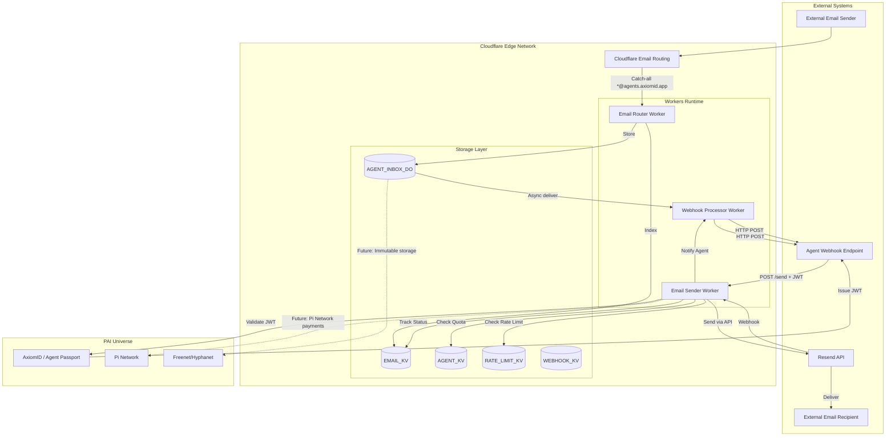
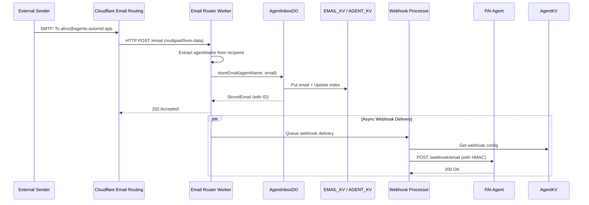
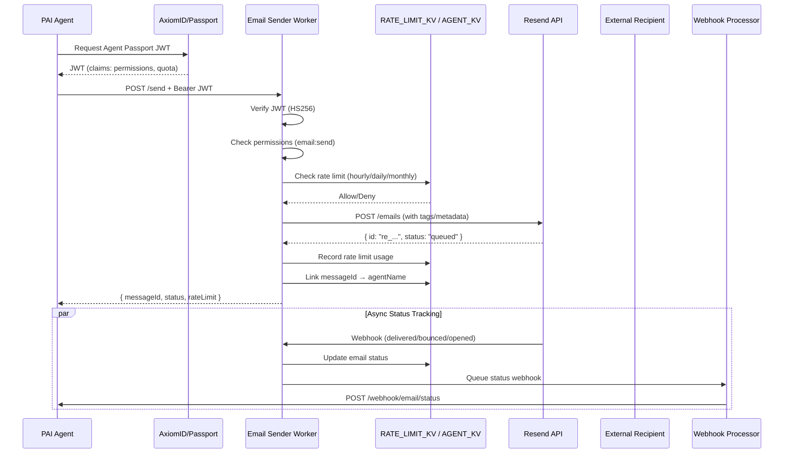
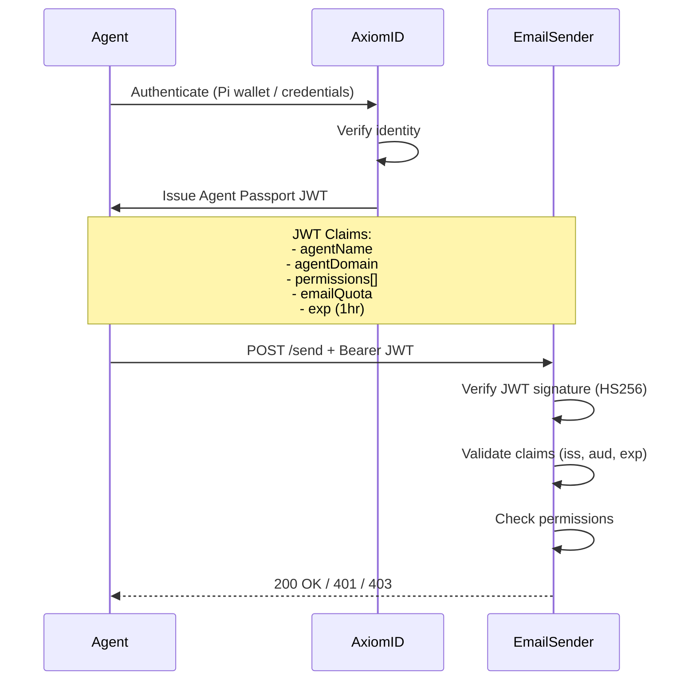

# PAI-Email-Agent Architecture

> **Technical architecture documentation for the PAI Email Infrastructure**

## 🏗️ System Overview



## 🔄 Data Flow Details

### Inbound Email Flow



### Outbound Email Flow



## 🧩 Component Architecture

### Email Router Worker (`pai-email-router`)

**Responsibilities:**
- Receive inbound emails from Cloudflare Email Routing
- Parse multipart/form-data email payloads
- Extract target agent from recipient address
- Store emails in AgentInboxDO (Durable Object)
- Queue webhook delivery to Webhook Processor

**Key Classes:**
- `AgentInboxDO` - Durable Object for per-agent email storage
- `parseEmailMessage()` - Parse Cloudflare email format
- `extractAgentName()` - Extract agent from `*@agents.axiomid.app`
- `deliverWebhookAsync()` - Fire-and-forget webhook queuing

**Scaling:** Stateless worker + sharded Durable Objects (one per agent)

### Email Sender Worker (`pai-email-sender`)

**Responsibilities:**
- Authenticate agents via JWT (Agent Passport)
- Validate send requests
- Enforce rate limits per agent quota
- Send emails via Resend API
- Track delivery status via Resend webhooks
- Notify agents of status changes

**Key Modules:**
- `sender.ts` - Core sending logic + Resend integration
- `resend-webhook.ts` - Process Resend delivery webhooks
- `status-tracker.ts` - Track status + notify agent webhooks

**Scaling:** Fully stateless, auto-scales with Cloudflare Workers

### Webhook Processor Worker (`pai-webhook-processor`)

**Responsibilities:**
- Process webhook delivery queue (cron-triggered)
- Handle retries with exponential backoff
- Manage dead letter queue for failed deliveries
- Batch webhook deliveries for efficiency

**Key Features:**
- Cron trigger every 30 seconds
- Configurable batch size (default 10)
- Exponential backoff: 1s, 2s, 4s, 8s... max 5min
- Dead letter queue after max retries (default 5)
- Manual retry endpoint for dead letters

**Scaling:** Single instance (cron), can shard by agent name if needed

### Shared Package (`@pai/email-shared`)

**Exports:**
- `types.ts` - All TypeScript interfaces (Email, Agent, Webhook, KV, etc.)
- `crypto.ts` - JWT (HS256), HMAC, hashing, rate limit keys, DKIM/SPF/DMARC helpers

## 💾 Data Models

### Email Storage (Durable Object)

```typescript
interface StoredEmail {
  id: string;                    // Message-ID or content hash
  agentName: string;             // "alice"
  from: EmailAddress;
  to: EmailAddress[];
  cc?: EmailAddress[];
  subject: string;
  text?: string;
  html?: string;
  headers: EmailHeaders;
  attachments: Attachment[];
  receivedAt: number;            // Unix ms
  size: number;                  // Bytes
  spamScore?: number;
  dkimResult?: 'pass' | 'fail' | 'none';
  spfResult?: 'pass' | 'fail' | 'none';
  dmarcResult?: 'pass' | 'fail' | 'none';
  processed: boolean;
  webhookDeliveredAt?: number;
  webhookAttempts: number;
}
```

### Agent Registration (KV)

```typescript
interface AgentRegistration {
  agentName: string;
  agentDomain: string;           // "alice.axiomid.app"
  emailAddress: string;          // "alice@agents.axiomid.app"
  webhookUrl: string;
  statusEndpoint: string;
  publicKey?: string;            // Future: webhook signature verification
  createdAt: number;
  updatedAt: number;
  status: 'active' | 'suspended' | 'pending_verification';
  permissions: AgentPermission[];
  emailQuota: EmailQuota;
  webhookConfig: {
    url: string;
    secret: string;
    events: WebhookEventType[];
    timeoutMs: number;
    maxRetries: number;
    retryDelayMs: number;
  };
}
```

### Rate Limiting (KV)

```
Key: ratelimit:{agentName}:{action}:{window}:{windowStart}
Value: count (integer)
TTL: windowMs + 60s buffer
```

Windows:
- `hourly` - 3,600,000ms (1 hour)
- `daily` - 86,400,000ms (24 hours)
- `monthly` - 2,592,000,000ms (30 days)

### Webhook Queue (KV)

```typescript
interface QueuedWebhook {
  id: string;
  agentName: string;
  event: WebhookEventType;
  payload: unknown;
  attempts: number;
  maxAttempts: number;
  createdAt: number;
  nextRetryAt: number;
  lastError?: string;
}
```

## 🔐 Security Architecture

### Authentication Flow



### Webhook Security

- **HMAC-SHA256** signatures on all webhook payloads
- **Per-agent secrets** stored in WEBHOOK_KV
- **Timestamp validation** (5-minute tolerance)
- **Replay protection** via correlation IDs

### Rate Limiting

- **Per-agent, per-action, per-window** limits
- **Burst allowance** for legitimate spikes
- **Graduated response**: 429 with Retry-After header

## 🌐 Network Topology

```
┌────────────────────────────────────────────────────────────────────┐
│                      Cloudflare Global Network                     │
├────────────────────────────────────────────────────────────────────┤
│                                                                    │
│  ┌──────────────┐    ┌──────────────┐    ┌──────────────────┐    │
│  │   Edge POP   │    │   Edge POP   │    │   Edge POP       │    │
│  │  (Email      │    │  (Email      │    │  (Webhook        │    │
│  │   Router)    │    │   Sender)    │    │   Processor)     │    │
│  └──────┬───────┘    └──────┬───────┘    └────────┬─────────┘    │
│         │                   │                       │             │
│         └───────────────────┼───────────────────────┘             │
│                             ▼                                     │
│  ┌────────────────────────────────────────────────────────────┐  │
│  │              Cloudflare KV (Global, Eventually Consistent) │  │
│  │  ┌─────────┐ ┌─────────┐ ┌─────────┐ ┌───────────────┐   │  │
│  │  │EMAIL_KV │ │AGENT_KV │ │RATE_LMT │ │  WEBHOOK_KV   │   │  │
│  │  └─────────┘ └─────────┘ └─────────┘ └───────────────┘   │  │
│  └────────────────────────────────────────────────────────────┘  │
│                             │                                     │
│         ┌───────────────────┼───────────────────────┐             │
│         ▼                   ▼                       ▼             │
│  ┌──────────────┐    ┌──────────────┐    ┌──────────────────┐    │
│  │ Durable      │    │ Durable      │    │ Durable          │    │
│  │ Objects      │    │ Objects      │    │ Objects          │    │
│  │ (Per Agent)  │    │ (Per Agent)  │    │ (Per Agent)      │    │
│  └──────────────┘    └──────────────┘    └──────────────────┘    │
│                                                                    │
└────────────────────────────────────────────────────────────────────┘
```

## 🔮 Future Extensions

### Phase 2: Pi Network Integration
- **Pi Payments**: Charge agents for email volume via Pi Network
- **Pi Wallet Auth**: Alternative to JWT for agent authentication
- **Pi KYC**: Verify agent identity via Pi Network KYC

### Phase 3: Freenet/Hyphanet Integration
- **Immutable Email Archive**: Store critical emails on Freenet
- **Decentralized Identity**: Sync Agent Passport to Freenet contracts
- **Censorship Resistance**: Email routing via Hyphanet if Cloudflare blocked

### Phase 4: Advanced Features
- **PGP/GPG Encryption**: End-to-end encrypted emails
- **Mailing Lists**: Agent-managed distribution lists
- **Email Templates**: Jinja2/Handlebars templates for agents
- **Analytics Dashboard**: Per-agent email metrics

---

*Architecture version: 0.1.0*
*Last updated: 2026-07-31*