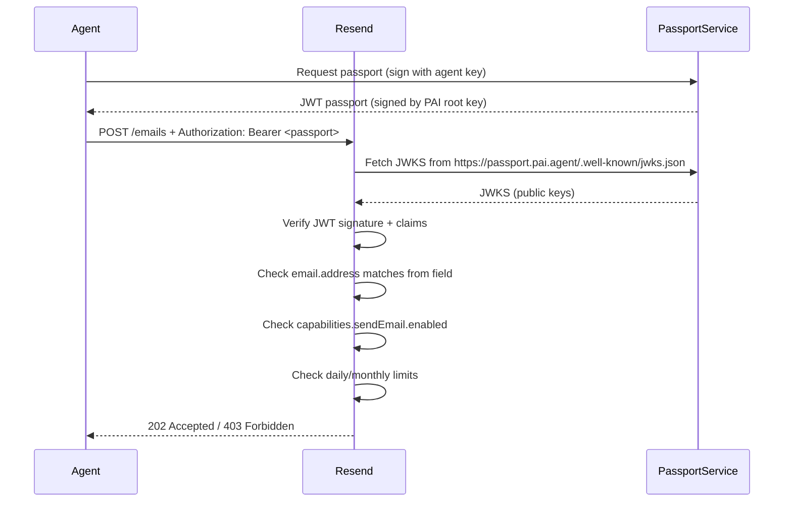

# Passport JWT Claims for Email Identity

## Overview

Agent Passports embed email identity as verifiable JWT claims. This enables:
- **Email verification** without revealing the underlying address
- **Delegated sending** — agents prove authorization to send from `agent@axiomid.app`
- **Cross-service trust** — services verify passport instead of managing allowlists

---

## Claim Structure

```json
{
  "iss": "https://passport.pai.agent",
  "sub": "did:axiom:agent:ag_xxx",
  "aud": ["https://api.resend.com", "https://axiomid.app"],
  "iat": 1700000000,
  "exp": 1700086400,
  "nonce": "crypto-random-32-bytes",
  
  "email": {
    "address": "agent@axiomid.app",
    "verified": true,
    "domain": "axiomid.app",
    "localPart": "agent",
    "routing": "cloudflare-email-worker"
  },
  
  "agent": {
    "id": "ag_xxx",
    "name": "PAI Agent",
    "subdomain": "agent.axiomid.app",
    "owner": "did:axiom:user:uuid",
    "status": "active",
    "mode": "autonomous"
  },
  
  "capabilities": {
    "sendEmail": {
      "enabled": true,
      "provider": "resend",
      "dailyLimit": 100,
      "monthlyLimit": 3000,
      "templates": ["welcome", "notification", "verification"]
    },
    "receiveEmail": {
      "enabled": true,
      "routing": "cloudflare-catch-all",
      "maxSizeKB": 64
    }
  },
  
  "permissions": {
    "scopes": ["email:send", "email:receive", "email:templates"],
    "delegatedFrom": ["did:axiom:user:uuid"],
    "delegatedTo": []
  }
}
```

---

## Claim Definitions

| Claim | Required | Description |
|-------|----------|-------------|
| `iss` | ✅ | Issuer: `https://passport.pai.agent` |
| `sub` | ✅ | Subject: Agent DID (`did:axiom:agent:{id}`) |
| `aud` | ✅ | Audience: Target services (Resend, AxiomID, etc.) |
| `iat` | ✅ | Issued at (Unix timestamp) |
| `exp` | ✅ | Expires at (Unix timestamp, max 24h) |
| `nonce` | ✅ | Cryptographic nonce (replay protection) |
| `email.address` | ✅ | Full email address |
| `email.verified` | ✅ | Domain verification status |
| `email.domain` | ✅ | Domain portion (e.g., `axiomid.app`) |
| `email.localPart` | ✅ | Local part (e.g., `agent`) |
| `email.routing` | ✅ | Routing mechanism (`cloudflare-email-worker`) |
| `agent.id` | ✅ | Stable agent ID (`ag_xxx`) |
| `agent.name` | ✅ | Display name |
| `agent.subdomain` | ✅ | Passport subdomain |
| `agent.owner` | ✅ | Human owner DID |
| `agent.status` | ✅ | `active` \| `paused` \| `sleeping` |
| `agent.mode` | ✅ | `autonomous` \| `supervised` \| `manual` |
| `capabilities.sendEmail.enabled` | ✅ | Whether agent can send |
| `capabilities.sendEmail.provider` | ✅ | Email provider (`resend`) |
| `capabilities.sendEmail.dailyLimit` | ✅ | Daily send limit |
| `capabilities.sendEmail.monthlyLimit` | ✅ | Monthly send limit (Resend free tier) |
| `capabilities.sendEmail.templates` | | Allowed template names |
| `capabilities.receiveEmail.enabled` | ✅ | Whether agent can receive |
| `capabilities.receiveEmail.routing` | ✅ | Routing mechanism |
| `capabilities.receiveEmail.maxSizeKB` | ✅ | Max email size |
| `permissions.scopes` | ✅ | OAuth2-style scopes |
| `permissions.delegatedFrom` | | DIDs that delegated to this agent |
| `permissions.delegatedTo` | | DIDs this agent delegated to |

---

## Verification Flow



---

## JWKS Endpoint

```
GET https://passport.pai.agent/.well-known/jwks.json
```

Response:
```json
{
  "keys": [
    {
      "kty": "OKP",
      "crv": "Ed25519",
      "kid": "pai-passport-2026-01",
      "x": "base64url-encoded-public-key",
      "use": "sig",
      "alg": "EdDSA"
    }
  ]
}
```

---

## Key Rotation

- **Rotation period**: 90 days
- **Overlap**: 30 days (both old + new keys valid)
- **Announcement**: `X-Passport-Key-Rotation` header on all responses
- **Revocation**: Compromised keys added to `/revoked-keys.json`

---

## Resend Integration

### Authorization Header

```
Authorization: Bearer <agent-passport-jwt>
```

### From Address Validation

Resend (or our worker) validates:
1. JWT signature valid
2. `email.address` claim matches `from` field in request
3. `capabilities.sendEmail.enabled === true`
4. Current usage < `dailyLimit` and `monthlyLimit`
4. `aud` includes `https://api.resend.com`

### Rate Limit Headers (Response)

```
X-RateLimit-Limit: 3000
X-RateLimit-Remaining: 2847
X-RateLimit-Reset: 1700086400
X-Passport-Version: 1
```

---

## Error Codes

| Code | HTTP | Description |
|------|------|-------------|
| `PASSPORT_INVALID` | 401 | JWT signature invalid or expired |
| `PASSPORT_EXPIRED` | 401 | `exp` < now |
| `EMAIL_MISMATCH` | 403 | `from` field ≠ `email.address` claim |
| `SEND_DISABLED` | 403 | `capabilities.sendEmail.enabled === false` |
| `DAILY_LIMIT_EXCEEDED` | 429 | Daily send limit reached |
| `MONTHLY_LIMIT_EXCEEDED` | 429 | Monthly send limit reached |
| `TEMPLATE_NOT_ALLOWED` | 403 | Template not in `capabilities.sendEmail.templates` |
| `DOMAIN_NOT_VERIFIED` | 403 | `email.verified === false` |

---

## Example: Agent Sends Welcome Email

```typescript
// Agent code
import { createPassport } from '@pai/agent-passport';
import { Resend } from 'resend';

const passport = await createPassport({
  agentId: 'ag_xxx',
  privateKey: agentPrivateKey, // Ed25519
  audience: 'https://api.resend.com'
});

const resend = new Resend(); // Uses RESEND_API_KEY from env

await resend.emails.send({
  from: 'PAI Agent <agent@axiomid.app>',
  to: 'user@example.com',
  subject: 'Welcome to PAI!',
  react: WelcomeTemplate({ agentName: 'PAI Agent' }),
  headers: {
    'Authorization': `Bearer ${passport}`,
    'X-Passport-Version': '1'
  }
});
```

---

## Security Considerations

1. **Short expiry** — Max 24h, prefer 1h for high-value operations
2. **Audience binding** — Passport only valid for declared `aud`
3. **Nonce uniqueness** — Reject replays (store recent nonces in KV)
4. **Key rotation** — Automated, zero-downtime
5. **Revocation list** — Check on every verification
6. **Rate limiting** — Enforced at Resend + Worker level
7. **Audit logging** — Every send logged to PAI_RECEIPTS KV